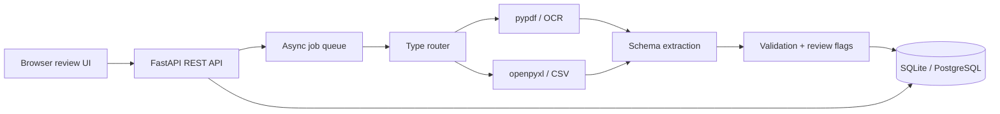

# Architecture and schema

## Data model

* `documents`: upload identity, SHA-256, type, status, timestamps and failure.
* `extracted_text`: normalized text and page/sheet count.
* `invoices`: JSON invoice payload, aggregate confidence and review flag.
* `validation_errors`: field/financial/duplicate findings with severity.
* `processing_history`: append-only lifecycle events for traceability.

## Reliability and security

The API validates extensions and upload size, generates server-side filenames, stores SHA-256 hashes, isolates processing exceptions into failed statuses, and does not expose upload paths. Production deployment should add authentication/authorization, malware scanning, rate limiting, object storage, a durable queue (Redis/BullMQ or Celery), encrypted secrets, and tenant-scoped queries.

For 1,000-page PDFs, replace the in-process task with a durable worker and stream pages/chunks through OCR. Persist page-level results and use idempotency keyed by SHA-256 to safely retry jobs.

The default `/api/search` uses transparent token-vector similarity so the offline demo has deterministic, auditable ranking without downloading a model. This is intentionally a documented alternative to embedding search, not a claim of neural semantic understanding. Production can replace that adapter with embeddings and pgvector/OpenSearch while preserving the endpoint contract.

Authentication is optional through `DOCUMENT_API_KEY` for local zero-configuration use and required in deployment. Role headers protect corrections and reprocessing, CORS is restricted through `ALLOWED_ORIGINS`, an in-process rate limiter protects the API, and uploads undergo extension/size/signature checks. Production should use a durable distributed rate limiter and ClamAV or a managed malware scanner.
