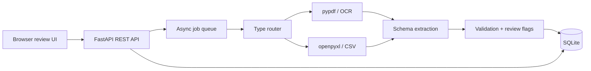

# Architecture and schema

## Data model

* `documents`: upload identity, SHA-256, type, status, timestamps and failure.
* `extracted_text`: normalized text and page/sheet count.
* `invoices`: JSON invoice payload, aggregate confidence and review flag.
* `validation_errors`: field/financial/duplicate findings with severity.
* `processing_history`: append-only lifecycle events for traceability.

## Reliability and security

The API validates extensions and upload size, generates server-side filenames, stores SHA-256 hashes, and isolates processing exceptions into failed statuses. It has optional shared-key authentication, basic signature scanning and an in-process rate limiter. Production deployment should add trusted identity-based authorization, a full antivirus engine, distributed rate limiting, object storage, a durable queue, encrypted secrets and tenant-scoped queries.

For 1,000-page PDFs, replace the in-process task with a durable worker and stream pages/chunks through OCR. Persist page-level results and use idempotency keyed by SHA-256 to safely retry jobs.

The default `/api/search` uses transparent token-vector similarity so the offline demo has deterministic, auditable ranking without downloading a model. This is intentionally a documented alternative to embedding search, not a claim of neural semantic understanding. Production can replace that adapter with embeddings and pgvector/OpenSearch while preserving the endpoint contract.

Authentication is optional through `DOCUMENT_API_KEY` for local zero-configuration use. The browser can send the configured key from an in-memory connection form. Role headers gate corrections, reprocessing and deletion, but are caller-supplied rather than verified identities. CORS is restricted through `ALLOWED_ORIGINS`. Use a trusted authentication layer before exposing the service to multiple users.

FastAPI's lifespan initializes the database. Database context managers commit or roll back and close connections. Reprocessing claims queued status inside a transaction; deletion rejects queued/processing jobs and cascades associated rows. PostgreSQL is a future migration option, not an installed backend.
